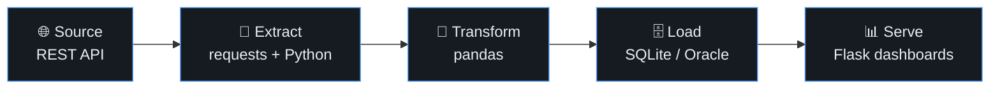
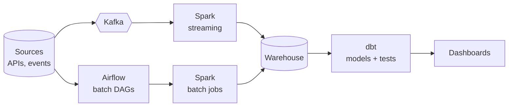

  

  

  
  
  

---

## About

I build data systems, not just with tools, but with the concepts behind them: data modeling, relational design, ETL pipelines, and how data moves from source to insight.

## Core strengths

<table>
  <tr>
    <td width="33%" valign="top">
      <h3>🗄️ Databases</h3>
      Relational modeling and normalization. Advanced SQL and PL/SQL on Oracle: procedures, functions, triggers, cursors.
    </td>
    <td width="33%" valign="top">
      <h3>🔄 Pipelines</h3>
      REST API → Python (pandas) → SQLite. Extract, transform, load, with persistent storage and CLI tooling.
    </td>
    <td width="33%" valign="top">
      <h3>🚀 Shipping</h3>
      Complete web apps with Flask (authentication, dashboards) and a Manifest V3 Chrome extension that runs on real pages.
    </td>
  </tr>
</table>

## Toolbox

  

<table>
  <tr>
    <td><b>Languages</b></td>
    <td>
      
      
      
      
      
      
    </td>
  </tr>
  <tr>
    <td><b>Data</b></td>
    <td>
      
      
      
      
    </td>
  </tr>
  <tr>
    <td><b>Apps</b></td>
    <td>
      
      
      
    </td>
  </tr>
  <tr>
    <td><b>Learning</b></td>
    <td>
      
      
      
      
      
    </td>
  </tr>
  <tr>
    <td><b>Workflow</b></td>
    <td>
      
      
      
      
      
    </td>
  </tr>
</table>

## Projects

<table>
  <tr>
    <td width="50%">
      
    </td>
    <td width="50%">
      
    </td>
  </tr>
  <tr>
    <td width="50%">
      
    </td>
    <td width="50%">
      
    </td>
  </tr>
</table>

| | Project | What it does | Stack |
|:-:|---|---|---|
| 🚗 | **[AutoRent](https://github.com/tahabentaleb/car_rental_stage)** | Car-rental booking manager built during my internship: secure login (hashed passwords, sessions), dashboard with statistics, car / customer / booking management | Python · Flask · SQLite |
| 🎬 | **[Browser Video Player](https://github.com/tahabentaleb/browser-video-player)** | Chrome extension that detects videos on any page and opens a dedicated player: playlist, 0.5–2× speed, fullscreen, Picture-in-Picture | JavaScript · Manifest V3 |
| 🌦️ | **[Weather CLI](https://github.com/tahabentaleb/weather-cli-tool)** | Command-line weather app fetching live data from the OpenWeatherMap API, with persistent SQLite search history | Python · REST API · SQLite |
| 🔐 | **[Password Generator](https://github.com/tahabentaleb/password-generator1)** | Web-based random password generator | HTML · CSS · JavaScript |

## GitHub stats

  
  

  

  

## GitHub metrics

## Now learning

Airflow · Spark · Kafka · dbt · Docker, heading toward an end-to-end batch + streaming capstone.

| Skill | Status |
|---|---|
| Relational modeling, SQL, PL/SQL | ✅ Done |
| ETL with Python and pandas | ✅ Done |
| Flask apps and Chrome extension | ✅ Done |
| Airflow | 🔄 In progress |
| Spark, Kafka, dbt, Docker | ⬜ Next |
| Batch + streaming capstone | ⬜ Goal |

## Education

**DUT in Data Engineering**, EST Kelaa des Sraghna, Cadi Ayyad University (2025 – Present)

**Certification:** Anthropic Claude 101, AI Fundamentals & Prompt Engineering (100%)

## Contact

  
  

